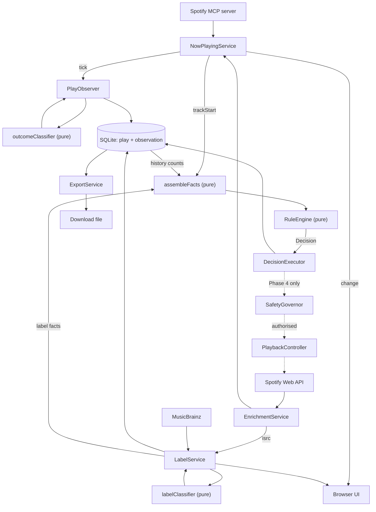

# Component Dependencies

**Date**: 2026-08-25 · **Stage**: INCEPTION — Application Design

---

## The dependency rule

**Pure components (⚙️) may not import impure components (🔌). Ever.**

This is checkable rather than aspirational: a pure module's import list must contain no
`node:fs`, `node:sqlite`, `node:net`, `fetch`, `Date.now`, or any service. Violating it silently
breaks back-testing (FR-42), which replays pure logic over stored history with no I/O available.

Dependencies flow one way: **services → impure components → pure components**.

---

## Dependency matrix

`→` depends on · `⚡` event subscription · blank = no dependency

| | Now­Playing | History Repo | Outcome Classifier | MB Client | Label Classifier | Rule Store | Rule Engine | Field Catalogue | Executor | Governor | Playback |
|---|---|---|---|---|---|---|---|---|---|---|---|
| **NowPlayingService** 🔌 | — | | | | | | | | | | |
| **HistoryService** 🔌 | ⚡ | → | → | | | | | | | | |
| **PlayObserver** 🔌 | ⚡ | → | → | | | | | | | | |
| **ExportService** 🔌 | | → | | | | | | | | | |
| **LabelService** 🔌 | | → | | → | → | | | | | | |
| **AutomationService** 🔌 | ⚡ | → | | | | → | → | → | → | | |
| **BackTestService** 🔌 | | → | → | | | | → | → | | | |
| **SkipExecutor** 🔌 | | | | | | | | | — | → | → |
| **DiagnosticsService** 🔌 | → | → | | → | | → | | | | → | |
| **outcomeClassifier** ⚙️ | | | — | | | | | | | | |
| **labelClassifier** ⚙️ | | | | | — | | | | | | |
| **predicate / RuleEngine** ⚙️ | | | | | | | — | → | | | |
| **fieldCatalogue** ⚙️ | | | | | | | | — | | | |

**Every pure row is empty except for pure-to-pure edges.** `RuleEngine → fieldCatalogue` is the
only one, and both are pure.

---

## Data flow

> Diagram not machine-validated — the repository's mermaid instructions route through Copilot LM
> tools unavailable in this session. Syntax kept simple; a copy is at
> [`data-flow.mmd`](data-flow.mmd).

**Dotted edges are Phase 4.** In Phase 3 they do not exist in code at all — `DecisionExecutor` has
a single logging implementation and no reference to `SafetyGovernor` or `PlaybackController`.

---

## Communication patterns

| Pattern | Where | Why |
|---|---|---|
| **Event emitter** | `NowPlayingService` → observers | Already the existing mechanism. Lets history and automation subscribe independently without either knowing about the other |
| **Direct call** | Services → components | Simple, synchronous, typed. No indirection where none is needed |
| **Interface + implementation** | `HistoryRepository`, `LabelCache`, `DecisionLog` | NFR-10: swapping SQLite for Postgres must not touch call sites |
| **Queue** | MusicBrainz access | Rate limiting enforced in one place; a new caller cannot bypass it |
| **Strategy** | `DecisionExecutor` | The Phase 3/4 boundary. Adding the ability to act is registering an implementation, not editing a conditional |
| **WebSocket push** | Server → browser | Existing |

---

## Cycles

**None.** Two near-cycles are broken deliberately:

1. **`PlayObserver` ↔ `outcomeClassifier`** is not a cycle — the observer calls the classifier and
   receives a value. The classifier holds no reference back.
2. **`LabelService` → `EnrichmentService`** would be circular if enrichment awaited labels.
   It does not: enrichment publishes an ISRC, the label service resolves asynchronously and
   updates the record afterwards. This is also what keeps MusicBrainz off the display path.

---

## Phase-by-phase dependency growth

| Phase | New edges | Existing code touched |
|---|---|---|
| **1** | `NowPlayingService --tick--> PlayObserver`; `ExportService → server` | `nowPlayingService.ts` (add `tick`), `server.ts` (download route), `config.ts` |
| **2** | `EnrichmentService --isrc--> LabelService`; `LabelService → repository` | `spotify/enrichment.ts` (surface ISRC, carry label) |
| **3** | `NowPlayingService --trackStart--> AutomationService` | `nowPlayingService.ts` (add `trackStart`), `server.ts` (rules read endpoints) |
| **4** | `SkipExecutor → SafetyGovernor → PlaybackController` | `spotify/webApiClient.ts` (`POST /me/player/next`) |

**Each phase adds edges without redirecting existing ones.** No phase requires rewiring what an
earlier phase built — which is the dependency-level expression of the execution plan's
containment goal.

---

## Coupling risks

| Risk | Mitigation |
|---|---|
| `nowPlayingService` becomes a hub with three consumers | Acceptable — it is the only source of truth for playback state. Kept as a plain emitter with no knowledge of subscribers |
| `TrackFacts` couples rules to every enrichment source | Intended. It is the deliberate seam that lets FR-27 work without the engine importing enrichment |
| Pure/impure boundary erodes under deadline pressure | The most likely failure. A single `Date.now()` inside the classifier would break FR-20 silently. Worth a lint rule or an explicit review check |
| Repository interface leaks SQL semantics | Keep filters as domain types, not SQL fragments |

The third row is the one to watch. It would not fail any test — it would just quietly make
historical re-classification produce different answers than the original run.
