# Execution Plan

**Date**: 2026-08-25 · **Stage**: INCEPTION — Workflow Planning
**Inputs**: [`../requirements/requirements.md`](../requirements/requirements.md) (55 FR, 27 NFR),
[`../user-stories/stories.md`](../user-stories/stories.md) (27 stories),
[`../user-stories/personas.md`](../user-stories/personas.md)

> **User instruction, 2026-08-25**: *"Break the effort up into a few phases that deliver a
> runnable/testable app so that each phase is not so complex it risks large rewrite cost in the
> event of a significant miss."*

That instruction is the organising principle of this plan. Phases are sequenced by **risk
containment**, not by architectural tidiness or by what is easiest to build first.

---

## 1. Change Impact Assessment

| Area | Impact |
|---|---|
| **User-facing changes** | **Yes.** The app gains label data, a rule authoring surface, and — at the end — the ability to act on playback. The last is a change in kind, not degree |
| **Structural changes** | **Yes.** Four new subsystems: persistence, external enrichment, rule evaluation, export |
| **Data model changes** | **Yes, and this is the highest-consequence area.** A listening-history schema intended to support statistical analysis months from now. Schema mistakes are expensive because the data is time-series and cannot be regenerated |
| **API changes** | **Minor and internal only.** New endpoints for rules and for the export download. **No external API** — withdrawn 2026-08-25 to the wishlist (§5.1, W-1) |
| **NFR impact** | **Persistence only.** Durability and concurrency concerns are new. The export-vs-guard conflict is **closed**: download-only integration leaves NFR-01–07 untouched |

### Risk Assessment

| | |
|---|---|
| **Overall risk level** | **Medium** |
| **Rollback complexity** | **Easy for code, hard for data.** Code is versioned and small. Accumulated listening history cannot be re-collected — a schema or classifier mistake discovered late is unrecoverable in a way a code bug is not |
| **Testing complexity** | **Moderate.** Pure logic is well covered by the existing property-test practice. The genuinely hard parts to test are time-dependent and playback-dependent: skip inference and queue lookahead |

### Where the real risk sits

Three areas dominate, and the phasing exists to separate them:

1. **The rules engine is the largest and least-certain component.** Field catalogue, predicate
   composition, tri-state evaluation. If the model is wrong, rework is substantial.
2. **The history schema is the most expensive to get wrong**, because unlike code it cannot be
   re-derived. This is why FR-19/FR-20 mandate storing raw evidence.
3. **Playback control is the only part that can cause visible harm.** Small surface, high
   consequence.

**The key structural decision in this plan is that risks 1 and 3 are placed in different
phases**, so the largest, least-certain component ships in a mode where it cannot do harm, and is
validated against real data before it is armed.

---

## 2. Delivery Phases

### Phase 0 — Delivered ✅

Display, enrichment, artwork, local-only enforcement, diagnostics, 100 tests, CI.
Stories US-01 to US-07, US-26. Live-verified against a real Spotify account.

---

### Phase 1 — **Remember**: start collecting the dataset

**Goal**: every track that plays is recorded, with a trustworthy outcome and the evidence behind
it. Nothing else changes.

| | |
|---|---|
| **Stories** | US-10, US-11, US-12, US-25, plus the recording side of US-13 |
| **Requirements** | FR-17–23, FR-49–54, NFR-08–13 |
| **Runnable state** | The app looks exactly as it does today, and silently accumulates history. A download button produces CSV/JSON |
| **How to verify** | Property tests on the outcome classifier (NFR-22). Listen for an hour; confirm plays, skips, pauses, seeks and replays are recorded correctly. Restart the container; confirm nothing was lost |
| **Risk** | **Low** |
| **Cost of a significant miss** | **Small.** The classifier is pure and its verdicts are recomputable from stored evidence (FR-20) — that requirement exists precisely so a wrong heuristic is a re-run, not a rewrite. Schema changes are handled by the migration requirement (NFR-12) that applies regardless |

**Why this is first**

- **The dataset is time-sensitive.** This was CQ4's whole rationale: preference modelling needs
  months of data, and every day without recording is a day permanently lost. Nothing else in the
  project has that property.
- **It depends on nothing.** No MusicBrainz, no rules, no playback control.
- **It de-risks everything after it.** Phases 2, 3 and 4 all consume this data.

> **Critical detail**: store the **ISRC** with every play. It arrives free on the existing
> `GET /tracks/{id}` call, and it is the join key to MusicBrainz. Storing it means **labels can
> be backfilled retrospectively in Phase 2** — so Phase 1 history is not wasted by shipping
> before label resolution exists. Omitting it would make the ordering of Phases 1 and 2 a
> one-way door. It is not.

**Exit criteria**
- [ ] A listening session is recorded end-to-end with correct outcomes
- [ ] Pause, seek, replay and session-end are each verified as *not* producing false skips
- [ ] History survives a container rebuild
- [ ] Export round-trips: downloaded CSV/JSON contains every field including raw evidence
- [ ] Export is obtainable as a one-action download from the UI
- [ ] ISRC is present on every recorded play

---

### Phase 2 — **Understand**: labels, and the first real test of the premise

**Goal**: resolve each track's label and classify it major / independent / unknown. Backfill
Phase 1 history using stored ISRCs.

| | |
|---|---|
| **Stories** | US-08, US-09 |
| **Requirements** | FR-12–16 |
| **Runnable state** | The display gains a label and its classification; history gains both, including for tracks recorded before this phase existed |
| **How to verify** | Live probe already proves the chain works (`USUM71703861` → `UMe`). Verify coverage rate across real listening; confirm rate limiting holds; confirm the display never stalls waiting for MusicBrainz |
| **Risk** | **Medium**, but contained to one module |
| **Cost of a significant miss** | **Moderate but bounded.** If MusicBrainz coverage proves too thin or classification too unreliable, only the enrichment module is affected. Phase 1's schema keeps ISRC regardless, so nothing already collected is invalidated |

**Why this is second — and this is the most important sequencing decision in the plan**

Phase 2 is where **R1 becomes testable**. With Phase 1 history plus Phase 2 labels, you can
export and answer the actual question: *does major-label placement correlate with my skips?*

That answer arrives **before** the rules engine is built — which matters, because the rules
engine's headline use case is premised on it. If the hypothesis fails, you learn it after two
contained phases rather than after building the entire engine on top of it.

> **Decision gate at the end of Phase 2.** Export the data and test the hypothesis before
> starting Phase 3. Possible outcomes:
> - **Hypothesis holds** → label-based rules are the priority in Phase 3.
> - **Hypothesis fails** → Phase 3 still proceeds; the engine's value never depended on this one
>   field. Age, artist and history-based rules remain useful, and US-09 still shows a true fact.
> - **Coverage too thin to tell** → decide whether to invest further in label resolution, or
>   proceed with the other field sources.
>
> In none of these outcomes is prior work discarded. That is the point of gating here.

**Exit criteria**
- [ ] Label resolves for a representative sample of real listening; coverage rate measured
- [ ] Classification records per-signal votes, not just a verdict
- [ ] `unknown` is visibly distinct from `independent`
- [ ] Phase 1 history successfully backfilled via stored ISRCs
- [ ] MusicBrainz never delays the now-playing display
- [ ] **Hypothesis tested against real data, and the result recorded**

---

### Phase 3 — **Decide**: the rules engine, unable to act

**Goal**: full rule authoring, evaluation, logging and back-testing — **with no playback control
whatsoever**. The app says what it *would* skip. It cannot skip.

| | |
|---|---|
| **Stories** | US-14, US-15, US-16, US-17, US-20, US-23, US-24 |
| **Requirements** | FR-24–33, FR-37, FR-41–45 |
| **Runnable state** | Rules can be authored, enabled, evaluated on every track, and back-tested against history. Every decision is logged. Nothing is ever skipped |
| **How to verify** | Property tests on tri-state logic and composition (NFR-25); determinism and round-trip tests (NFR-26/27); back-test rules against Phase 1–2 history and compare against actual skips |
| **Risk** | **High complexity, low consequence** — deliberately |
| **Cost of a significant miss** | **Contained.** If the predicate model or field catalogue is wrong, the rewrite touches an inert component. No playback is affected, no data is corrupted, and back-testing surfaces the problem before anything is armed |

**Why the rules engine ships without the ability to act**

This is the plan's central risk-containment move, and it is worth being explicit about the
reasoning:

- The rules engine is the **largest and least-certain** component. It is therefore the one most
  likely to need significant rework.
- Playback control is what makes a wrong rule *harmful*. Separating them means the risky
  component is exercised extensively in a mode where being wrong costs nothing.
- **Back-testing (US-24) against Phase 1–2 history is a genuine correctness check**, not a
  nicety. A rule can be replayed over months of real listening and compared against what you
  actually did — before it is ever allowed to touch playback.
- Phase 3 is **independently useful even if Phase 4 never happens**. "Tell me what you would have
  skipped last week" has standalone value.

**Exit criteria**
- [ ] A rule can be composed over fields from every source: Spotify, derived, MusicBrainz,
      context, history
- [ ] Tri-state evaluation verified — `unknown` never collapses to `false`, including under NOT
      and OR
- [ ] Invalid rules rejected at creation, not at evaluation
- [ ] Rules round-trip through storage without behaviour change
- [ ] Back-test produces identical results on repeated runs
- [ ] A dry-run session over real listening produces a match log you agree with
- [ ] **Confirmed: no code path can initiate a skip**

---

### Phase 4 — **Act**: arm it, carefully

**Goal**: allow rules to skip, with the safety mechanisms that make that reversible.

| | |
|---|---|
| **Stories** | US-18, US-19, US-21, US-22, and completing US-13 |
| **Requirements** | FR-34–36, FR-38–40, FR-46–48 |
| **Runnable state** | The complete product. Rules act; kill switch, rate limit and runaway halt are live |
| **How to verify** | Skip verified against live playback. Deliberately author a match-everything rule and confirm the runaway guard halts it. Confirm the kill switch stops action immediately and survives restart. Confirm rule-initiated skips are recorded distinctly from user skips |
| **Risk** | **Medium** — small surface, high consequence |
| **Cost of a significant miss** | **Low rework, but the only phase that can visibly disrupt listening.** Mitigated by arriving last, on rules already validated by dry-run and back-testing |

**What is verified here for the first time**

**R11 — queue lookahead.** `GET /me/player/queue` is confirmed reachable (200 in Development
Mode) but was probed with nothing playing and returned an empty queue. Whether it yields useful
lookahead during active playback is **unverified**, and US-18's pre-warming criterion depends on
it. Probe this **at the start of Phase 4**, before designing around it.

If lookahead proves unavailable, the fallback is already specified: evaluate fast fields
immediately, re-evaluate within the decision window, act on deadline expiry and record the
decision as partial (FR-34/35). The feature degrades; it does not fail.

**Exit criteria**
- [ ] Queue lookahead probed during active playback; result recorded either way
- [ ] A matched track is skipped, silently, with no confirmation prompt
- [ ] A failed skip is surfaced and does not loop
- [ ] Runaway guard halts a deliberately over-broad rule
- [ ] Kill switch halts immediately and persists across restart
- [ ] Rule-initiated skips recorded distinctly and excluded from preference signal
- [ ] Automation confirmed off by default on a fresh install

---

### Phase 5 — **Share**: off this machine, and off one developer

**Added 2026-10-06**, after Phases 0–4 delivered. ⚠️ **This phase adds no user-facing feature**, and that
is the point: the deliverable is that a second person can review, run and contribute without the
project's accumulated tacit knowledge, and that a deployment can live somewhere other than this laptop.

| | |
|---|---|
| **Goal** | A second machine runs it; a second person can install and contribute |
| **Runnable state** | Unchanged functionally. What changes is who can reach it and who can work on it |
| **How to verify** | Reachable from a second machine under a chosen security posture · **WAL probed on the NAS volume** · WebSocket verified both directions · a contributor walks the install **cold** |
| **Risk** | ⚠️ **Medium–High, and of a different kind** — the first phase whose failure mode is *exposure* rather than *a wrong number* |
| **Cost of a significant miss** | ⚠️ **Asymmetric.** A mistake here can expose listening history or a Spotify refresh token on a network. Every earlier phase's worst case was recoverable data |

⚠️ **The single-USER assumption does not change.** Each developer or user runs **their own deployment**
with their own Spotify account and their own corpus. This is not multi-tenancy, and no user model is
needed for separation — only, possibly, for access.

⚠️ **Containment is deliberate**: the off-machine target is on the user's own LAN, so the security model
is worked out without internet exposure in the same step.

**The blocker, measured 2026-10-06**: `localGuard.ts` requires a **loopback `Host` header**, so an
off-machine request 403s — page and WebSocket alike. That is option B (2026-09-05) working as specified,
and changing it is a **security-posture decision**, surfaced rather than decided.

**Units**

| Unit | Delivers | Gates |
|---|---|---|
| **U6** User-Data Lifecycle | Full backup, verified restore, **cross-machine migration** | ⚠️ **Prerequisite for everything else in the phase** |
| **U7** Off-machine deployment | The NAS target, under a chosen security posture | U6 |
| *(later)* team workflow + onboarding docs | CI gating, README/INSTALL/CONTRIBUTING/LICENSE | — |

⚠️ **U6 is the gate, and it is the first unit in the project with NO user story** — U7 is its consumer.
The `db:backup` / `db:restore` pair already works, so the migration is feasible today; what makes it
unsafe is that **the writer-guard goes blind across machines**, the backup covers `history.db` only, and
**restore is one-way with no merge**.

▶ **Seven questions open**: [`phase-5-plan.md`](phase-5-plan.md), and six more in
[`u6-functional-design-plan.md`](../../construction/plans/u6-functional-design-plan.md). Nothing is
designed until they are answered.

---

### Phase summary

| Phase | Delivers | Complexity | Consequence of a miss | Depends on |
|---|---|---|---|---|
| **1 Remember** | History + export | Low–Medium | Small — verdicts recomputable | — |
| **2 Understand** | Labels + hypothesis test | Medium | Bounded to one module | Phase 1 (backfillable) |
| **3 Decide** | Rules, dry-run only | **High** | **Contained — cannot act** | Phases 1–2 |
| **4 Act** | Playback control + safety | Medium | Visible but reversible | Phase 3 |
| **5 Share** | Off-machine deployment + team workflow | Medium | ⚠️ **Exposure, not data** — the first phase whose miss is not recoverable by recomputing | Phase 4 |

**Every phase leaves a runnable, testable, independently useful app.** No phase requires the next
one to justify itself.

---

## 3. Workflow Visualisation

> **Note**: the repository's mermaid instructions direct diagrams through Copilot's
> `mermaid-diagram-validator` / `mermaid-diagram-preview` LM tools. Those tools are not available
> in this session, so this diagram has **not** been machine-validated. Syntax was kept
> deliberately simple. A copy is at [`execution-plan.mmd`](execution-plan.mmd) for preview in the
> Mermaid extension.

```mermaid
flowchart TD
    Start(["User Request"])

    subgraph INCEPTION["🔵 INCEPTION PHASE"]
        WD["Workspace Detection<br/><b>COMPLETED</b>"]
        RE["Reverse Engineering<br/><b>SKIPPED</b>"]
        RA["Requirements Analysis<br/><b>COMPLETED</b>"]
        US["User Stories<br/><b>COMPLETED</b>"]
        WP["Workflow Planning<br/><b>COMPLETED</b>"]
        AD["Application Design<br/><b>EXECUTE</b>"]
        UG["Units Generation<br/><b>EXECUTE</b>"]
    end

    subgraph CONSTRUCTION["🟢 CONSTRUCTION PHASE"]
        FD["Functional Design<br/><b>EXECUTE per phase</b>"]
        NFRA["NFR Requirements<br/><b>SKIP</b>"]
        NFRD["NFR Design<br/><b>EXECUTE</b>"]
        ID["Infrastructure Design<br/><b>EXECUTE</b>"]
        CG["Code Generation<br/><b>EXECUTE x4</b>"]
        BT["Build and Test<br/><b>EXECUTE x4</b>"]
    end

    subgraph OPERATIONS["🟡 OPERATIONS PHASE"]
        OPS["Operations<br/><b>PLACEHOLDER</b>"]
    end

    Start --> WD
    WD --> RE
    RE --> RA
    RA --> US
    US --> WP
    WP --> AD
    AD --> UG
    UG --> FD
    FD --> NFRA
    NFRA --> NFRD
    NFRD --> ID
    ID --> CG
    CG --> BT
    BT --> OPS
    OPS --> End(["Complete"])

    style WD fill:#4CAF50,stroke:#1B5E20,stroke-width:3px,color:#fff
    style RA fill:#4CAF50,stroke:#1B5E20,stroke-width:3px,color:#fff
    style US fill:#4CAF50,stroke:#1B5E20,stroke-width:3px,color:#fff
    style WP fill:#4CAF50,stroke:#1B5E20,stroke-width:3px,color:#fff
    style CG fill:#4CAF50,stroke:#1B5E20,stroke-width:3px,color:#fff
    style BT fill:#4CAF50,stroke:#1B5E20,stroke-width:3px,color:#fff
    style RE fill:#BDBDBD,stroke:#424242,stroke-width:2px,stroke-dasharray: 5 5,color:#000
    style NFRA fill:#BDBDBD,stroke:#424242,stroke-width:2px,stroke-dasharray: 5 5,color:#000
    style AD fill:#FFA726,stroke:#E65100,stroke-width:3px,stroke-dasharray: 5 5,color:#000
    style UG fill:#FFA726,stroke:#E65100,stroke-width:3px,stroke-dasharray: 5 5,color:#000
    style FD fill:#FFA726,stroke:#E65100,stroke-width:3px,stroke-dasharray: 5 5,color:#000
    style NFRD fill:#FFA726,stroke:#E65100,stroke-width:3px,stroke-dasharray: 5 5,color:#000
    style ID fill:#FFA726,stroke:#E65100,stroke-width:3px,stroke-dasharray: 5 5,color:#000
    style OPS fill:#BDBDBD,stroke:#424242,stroke-width:2px,stroke-dasharray: 5 5,color:#000
    style Start fill:#CE93D8,stroke:#6A1B9A,stroke-width:3px,color:#000
    style End fill:#CE93D8,stroke:#6A1B9A,stroke-width:3px,color:#000

    linkStyle default stroke:#333,stroke-width:2px
```

---

## 4. Stages to Execute

### 🔵 INCEPTION PHASE
- [x] Workspace Detection — COMPLETED
- [x] Reverse Engineering — SKIPPED (greenfield)
- [x] Requirements Analysis — COMPLETED, approved 2026-08-25
- [x] User Stories — COMPLETED, approved 2026-08-25
- [x] Workflow Planning — COMPLETED (this document)
- [ ] **Application Design — EXECUTE**
  - *Rationale*: Four new components with non-trivial boundaries — persistence/repository,
    MusicBrainz client, rule engine, export. The rule engine in particular needs its interfaces
    defined before code, since FR-27's "any field" demands a field-catalogue abstraction rather
    than hard-coded field access
- [ ] **Units Generation — EXECUTE**
  - *Rationale*: New data models and schemas, and this is the highest-consequence area in the
    project. The history schema cannot be re-derived from anything if it turns out wrong

### 🟢 CONSTRUCTION PHASE
- [ ] **Functional Design — EXECUTE, once per delivery phase**
  - *Rationale*: Designing all four phases up front would defeat the purpose of phasing. Each
    phase's design should absorb what the previous phase learned — especially Phase 3, which
    should be designed after the Phase 2 hypothesis gate
- [ ] **NFR Requirements — SKIP**
  - *Rationale*: 27 NFRs are already enumerated and agreed in `requirements.md` §4, with the
    security extension scoped (Q9) and PBT scoped (Q10). Re-deriving them would duplicate settled
    work
- [ ] **NFR Design — EXECUTE (narrow)**
  - *Rationale*: One genuinely new NFR problem needs design — persistence durability and
    concurrency (NFR-08–13). The export-vs-local-only conflict **closed on 2026-08-25**: with
    download-only integration, no security design work is required and NFR-01–07 stand as built
- [ ] **Infrastructure Design — EXECUTE (narrow)**
  - *Rationale*: Compose needs a persistent volume for the history database, so a rebuild does not
    destroy accumulated history (NFR-11). Also the point at which `MCP_SERVER_REF` should finally
    be pinned (R7). No networking changes — the download route adds no new exposure
- [ ] **Code Generation — EXECUTE, once per delivery phase**
- [ ] **Build and Test — EXECUTE, once per delivery phase**

### 🟡 OPERATIONS PHASE
- [ ] Operations — PLACEHOLDER

---

## 5. Success Criteria

**Primary goal**: a local app that records what Spotify plays, explains what it is playing, and
filters it according to rules the user writes — while collecting a dataset honest enough to test
whether the premise behind those rules is true.

**Key deliverables**: listening history with trustworthy outcomes · label classification with
per-signal provenance · a general rules engine over any known field · automated skipping with
working safety interlocks · exports that external tools can consume.

**Quality gates**, applied at every phase:
- Typecheck clean across `src` and `test`
- Full suite green, property tests included, CI passing with a logged seed
- No regression in the local-only guarantee (NFR-01–07)
- New pure logic covered by property tests (NFR-20, 22, 25)
- Live verification against a real Spotify account — this project has been wrong twice when
  reasoning from documentation, and both times a live probe caught it

**Phase-specific gate**: Phase 2 ends with the hypothesis tested against real data. That result
is recorded whether it supports the premise or not.

---

## 6. Open Items Carried Forward

| # | Item | Needed by |
|---|---|---|
| R11 | Queue lookahead unverified during active playback | Start of Phase 4 |
| ~~R7~~ | ~~`MCP_SERVER_REF` unpinned~~ — **CLOSED 2026-08-25**, pinned to `7b5fde63` (2026-08-21) | ✅ Done |
| R1 | Promotion hypothesis unproven | Tested at the Phase 2 gate |
| Q-B | Exemption / allow rules deferred; seams preserved | Revisit after Phase 4 |
| W-1 | HTTP data API for live dashboards — deferred pending a security architecture (§5.1) | Only if download-and-import proves genuinely insufficient |

**Closed 2026-08-25**: the export-vs-local-only conflict. Download-only integration means no
security work is on any phase's critical path, and NFR-01 to NFR-07 stand exactly as built.
